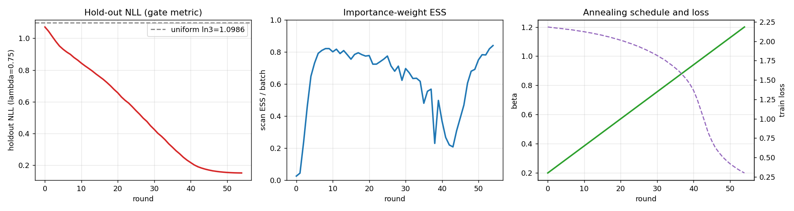
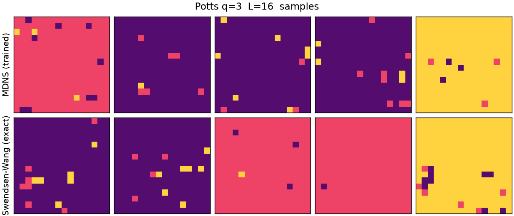

# SakuraMDNS

A masked-diffusion **neural sampler** for 2-D lattice spin models, built on
[MDNS](https://arxiv.org/abs/2508.10684) (NeurIPS 2025), re-engineered for speed,
portability and unattended training.

The model learns to sample from `π(x) ∝ exp(-β H(x))` for the 2-D Ising and
q-state Potts models — a distribution that is only known up to its normalising
constant — and is trained purely on **its own samples** (no ground-truth data).
A held-out likelihood gate decides whether a new set of weights replaces the
incumbent, so a bad round can never poison the next scan.

- **C++ MCMC stack** — 5 kernels (MH / heat-bath / Swendsen-Wang, Ising + Potts)
  built as a small DLL/`.so`, up to **489× faster** than the original pure-python
  samplers, validated against exact enumeration.
- **LatticeNet** — a periodic-lattice backbone (circular convolutions) with
  configurable **nested-bottleneck + Transformer** residual blocks, 0.02M–1.3M
  parameters, selected by name from a registry.
- **Closed training loop** — scan → write shard → train → gate → promote/reject,
  resumable, with β annealing, LR decay on rejection and bounded disk usage.
- **Muon** optimiser (Newton–Schulz orthogonalised updates) for matrix weights.
- Runs unchanged on **NVIDIA CUDA**, **Intel XPU** and **CPU**.

## Results

| what | number | where |
|---|---|---|
| C++ MCMC vs the original python samplers | **54-489x** faster (5 kernels, exact-enumeration validated 8/8) | [item 1](results/RESULTS_item1.md) |
| GPU samplers (checkerboard / Wolff) on an Intel iGPU | 0.11-0.44x of the CPU kernels -- *slower*, so unused | [item 2](results/RESULTS_item2.md) |
| NBT bottleneck + Transformer, compression ratio sweep | ratio **2** matches `res-m` with 7x fewer params / 7.4x less compute | [item 3/6](results/RESULTS_item3_6.md) |
| Muon vs AdamW, equal wall-clock | **-0.0029 NLL** for Muon (costs 1.37x per step) | [item 7](results/RESULTS_item4_5_7.md) |
| closed loop, 3 h on a 4080S (Potts L=16, beta=1.2) | hold-out NLL **1.071 -> 0.152**, ESS **0.026 -> 0.839**, 55/55 rounds promoted | [3 h run](results/RESULTS_train_3h.md) |
| quality of the trained sampler vs exact Swendsen-Wang | ESS **0.946**, energy **+0.45%**, energy TV **0.086**, 2-pt correlation error **0.0087** | [eval](results/RESULTS_eval_L16.md) |
| `--compile` + `--compile-train` | **2.14x** shorter rounds (strict A/B) | [throughput](results/RESULTS_throughput.md) |
| training step vs the upstream project | **6.0x** per optimizer step, **9.7x** in samples/second | below |

### Sampling speed (CPU, L=16, B=128, β_critical / β=1.2)

| kernel | python sweeps/s | C++ sweeps/s | speed-up |
|---|---|---|---|
| Ising MH | 63.1 | 5 671 | **89.9×** |
| Ising Swendsen-Wang | 8.8 | 3 878 | **439.6×** |
| Potts MH | 30.7 | 3 820 | **124.4×** |
| Potts heat-bath | 44.8 | 2 413 | **53.9×** |
| Potts Swendsen-Wang | 8.0 | 3 924 | **489.0×** |

All five kernels pass an exact-enumeration test (TV ≤ 0.008 on Ising L=4 and
Potts L=3) and agree with each other at L=16 within 1e-3 in energy per site.
Details and the bugs this caught: [results/RESULTS_item1.md](results/RESULTS_item1.md).

> A GPU implementation (checkerboard heat-bath and batched Wolff clusters) also
> ships in `mdns/samplers/gpu.py` and is validated, but on the integrated GPU we
> tested it is **0.11–0.44×** the speed of the C++ CPU kernels — the problem is
> too small to amortise kernel-launch overhead. See
> [results/RESULTS_item2.md](results/RESULTS_item2.md).

### Bottleneck compression (denoising proxy, L=16, 300 steps)

| preset | params | fwd GFLOPs | NLL@λ=0.75 |
|---|---|---|---|
| `res-s` | 0.168 M | 5.4 | **0.4814** |
| `res-m` | 0.446 M | 14.5 | 0.4814 |
| **`nbt-2`** | **0.064 M** | **1.96** | **0.4844** |
| `nbt-4` | 0.023 M | 0.65 | 0.4922 |
| `nbt-8` | 0.010 M | 0.25 | 0.5254 |

Compression ratio **2** is the sweet spot: same quality as `res-m` with **7×
fewer parameters and 7.4× less compute**. Ratio 8 clearly degrades.
[results/RESULTS_item3_6.md](results/RESULTS_item3_6.md)

### Muon vs AdamW (equal wall-clock, same proxy task)

| optimiser | best LR | steps/s | val NLL |
|---|---|---|---|
| AdamW | 1e-3 | 11.7 | 0.4805 |
| **Muon** | 1e-2 | 8.5 | **0.4775** |

Muon costs 1.37× per step but still wins at equal time.
[results/RESULTS_item4_5_7.md](results/RESULTS_item4_5_7.md)

### A real training run (RTX 4080 SUPER, 2.38 h)

Potts q=3, L=16, β=1.2, `res-s` (0.168 M params), 55 rounds × 700 steps:



| metric | round 0 | round 54 |
|---|---|---|
| hold-out NLL (gate) | 1.07124 | **0.15166** (−86.2% vs uniform ln 3) |
| scan ESS / batch | 0.026 | **0.839** |
| gate decisions | — | **55/55 promoted** |

Sampling with the final EMA weights and comparing to exact Swendsen-Wang
(4096 samples each): scan ESS **0.946**, energy per site **−1.89004 vs −1.89862
(+0.45%)**, energy TV **0.086**, magnetisation TV **0.060**, 2-point correlation
max error **0.0087**. The sampler is slightly "too hot" — the model only spent
the last ~10 rounds at the target β.
[results/RESULTS_train_3h.md](results/RESULTS_train_3h.md) ·
[results/RESULTS_eval_L16.md](results/RESULTS_eval_L16.md)

| MDNS (top) vs exact Swendsen-Wang (bottom) |
|---|
|  |

## Install

```bash
git clone https://github.com/SakuraGoH/SakuraMDNS
cd SakuraMDNS
pip install -r requirements.txt          # pick the torch build for your device first
```

The C++ samplers are a single translation unit with a flat C ABI, loaded via
`ctypes` (no pybind11, no ninja, no torch extension build):

```bash
# Linux / macOS
mkdir -p mdns/samplers/build
g++ -O3 -march=native -fopenmp -fPIC -shared -std=c++17 \
    mdns/samplers/cpp/samplers.cpp -o mdns/samplers/build/libmdns_samplers.so

# Windows (MSVC + OpenMP)
pwsh scripts/build_cpp.ps1 -Force
```

Sanity check (no GPU needed):

```bash
python scripts/validate_samplers.py     # 8/8 exact-enumeration tests
```

## Quick start

```bash
# small end-to-end run: L=8, 6 rounds, ~1 minute on a laptop GPU
python scripts/run_closed_loop.py --arch res-s --L 8 --q 3 --rounds 6 \
    --steps-per-round 60 --resample-every 15 --scan-batch 512 \
    --beta 0.4 --beta-start 0.15 --out-dir runs/demo

# inspect it
python scripts/show_metrics.py runs/demo/metrics.json
```

Evaluate a checkpoint against the exact sampler:

```bash
python scripts/eval_checkpoint.py --ckpt runs/demo/best.pt --beta 0.4 --n 4096 \
    --out results/eval_demo
# -> samples.png, observables.png, eval_report.json
```

## Training at scale

`scripts/train_cloud.sh` (fixed 8 h, two stages) and `scripts/train_forever.sh`
(unbounded, crash-recovering) wrap the loop with the settings we found to work:

```bash
nohup bash scripts/train_forever.sh > logs/forever.log 2>&1 &
tail -f logs/forever.log        # live output (the process writes to the log file)
```

The recommended architecture is the `nbt-2` preset widened to 6 blocks:

| | |
|---|---|
| blocks | 6 |
| trunk channels | 64 |
| compression ratio | 2 → bottleneck width **32** |
| Transformer width | 32 (at the bottleneck of every block) |
| attention heads | 4 (head_dim 8) |
| inner blocks per NBT block | 2 |
| parameters | **95 876** |
| scan cost (L=16, B=1024, RTX 4080S) | 7.4 s |

Override any of these from the command line — no code edits needed:

```bash
python scripts/run_closed_loop.py --arch nbt-2 --n-blocks 6 --channels 64 \
    --compression-ratio 2 --n-inner 2 --n-heads 4 ...
```

## Architecture

```
token ids (B, L²)
  → Embedding(vocab → C)                        vocab = q + 1, last token = MASK
  → reshape (B, C, L, L)
  → [ ResBlock | NBTBlock ] × n_blocks          all convs use circular padding
  → GroupNorm → 1×1 conv head → (B, L², vocab) logits
```

`NBTBlock` is the nested-bottleneck residual block:

```
x ─► 1×1 compress C → C/ratio
     → [depthwise-separable 3×3] × n_inner
     → Transformer block (global attention at the compressed width)
     → 1×1 expand back to C
     → + x        (LayerScale γ, initialised to 0)
```

Circular padding because the physics uses periodic boundaries — zero padding
would invent a boundary the Hamiltonian does not have. Attention has **no
positional encoding** by default: a periodic lattice should be
translation-equivariant, and local position is already carried by the conv
features. LayerScale γ starts at zero so every block is an identity map at
initialisation.

### Model naming

Every weight set carries a canonical name of the form

```
sakura-b<blocks>c<channels>h<heads>nbt<compression ratio>tf-s<total samples scanned>
        │        │          │          │            │   └─ cumulative samples seen so far
        │        │          │          │            └───── transformer at the bottleneck
        │        │          │          └────────────────── bottleneck compression ratio (2/3/4)
        │        │          └───────────────────────────── attention heads
        │        └──────────────────────────────────────── trunk channels
        └───────────────────────────────────────────────── residual blocks
```

e.g. `sakura-b6c64h4nbt2tf-s1474560` is the 6-block / 64-channel / 4-head /
ratio-2 NBT+Transformer model after 1 474 560 scanned samples. Pure residual and
ViT models drop the parts that do not apply (`sakura-b4c48`, `sakura-vit-b6c64h4`).

The name lives **inside** the checkpoint (`arch["name"]` holds the architecture
part, `sakura_name` the full name with the sample counter, `total_samples` the
raw integer), so moving or renaming `best.pt` never changes the identity of the
weights. The training loop prints the full name on every round:

```
  round 60: sakura-b6c64h4nbt2tf-s1474560  beta=1.200 ESS=0.4x loss=... -> promoted  [261.5s]
```

Backbones are chosen by name from [`mdns/models/registry.py`](mdns/models/registry.py):

| preset | block | C | blocks | ratio | attention | params |
|---|---|---|---|---|---|---|
| `res-s` | res | 48 | 4 | — | ✗ | 0.168 M |
| `res-m` | res | 64 | 6 | — | ✗ | 0.446 M |
| `res-l` | res | 96 | 8 | — | ✗ | 1.333 M |
| `nbt-1` | nbt | 64 | 4 | 1 | ✓ | 0.209 M |
| `nbt-2` | nbt | 64 | 4 | 2 | ✓ | 0.064 M |
| `nbt-4` / `nbt-8` | nbt | 64 | 4 | 4 / 8 | ✓ | 0.023 / 0.010 M |
| `nbt-4-noattn` | nbt | 64 | 4 | 4 | ✗ | 0.014 M |
| `vit-64x6` | RopeViT | 64 | 6 | — | ✓ | 0.318 M |

`vit-64x6` is the upstream MDNS model, kept as a reference baseline
(`mdns/models/ropevit/`, requires `timm`).

## The closed loop and its gatekeeper

One round:

1. **scan** — the current EMA weights act as the sampler and produce
   `(x, log_rnd)`, where `log_rnd` accumulates `log π(x) − log q_θ(x)`
2. **write** — the shard is persisted (`runs/<id>/round_XXXXXX.npz`)
3. **train** — weighted denoising cross-entropy on that shard, re-scanning every
   `--resample-every` steps so one scan is never over-fitted
4. **gate** — score the candidate on a held-out set
5. **promote / roll back** — keep the new weights only if they are better

**The gate does not use ESS.** ESS → 1 is necessary but *not* sufficient for
`q_θ = π`: a model collapsed onto a single configuration produces *constant*
importance weights, so its ESS is also 1. Gating on ESS would happily promote a
collapsed model. The default metric is a proper scoring rule — the mean
cross-entropy of the clean token at masked positions on held-out configurations
drawn from the exact sampler — which a degenerate model cannot game.

Two subtleties that matter for long runs:

- **β must be annealed.** At low temperature the self-normalised importance
  weights degenerate (we measured ESS ≈ 0.008, i.e. ~5 of 512 samples carrying
  all the weight) and training over-fits them. Starting at β=0.15–0.2 keeps ESS
  at 0.3–0.8 and lets the sampler bootstrap.
- **The reference set must be re-drawn.** With a fixed 2048-configuration
  reference the model eventually memorises it and the gate stops being honest.
  `--gate-ref-refresh 20` re-draws it and re-scores the incumbent on the new set.

## Two-stage curriculum: inherit data, not weights

`scripts/train_curriculum.sh` replaces "resume the previous run" with a
data-level handover, which is how a student can end up *better* than its teacher.

1. **Stage 1** (`--warmup-shards`, `--warmup-ckpt`) trains a fresh model on
   shards a previous model produced, until its gate score catches up.  The shards
   carry self-normalised importance weights for pi, so replaying them is a valid
   off-policy estimate: the student inherits the teacher's *data*, not its
   weights -- and therefore not its bias.  Distillation has a hard ceiling (the
   teacher's own score) and the measurement confirms it: the student plateaus
   5e-5 short, and a 3.8x wider student only closes 2e-5 of that.
2. **Stage 2** (`--window-rounds W`) switches to self-generated data with a
   bounded sliding replay window, and this is where it overtakes the teacher.

Potts q=3, L=16, beta=1.2, n=16384 against one shared exact reference
(1 sigma = 3.6e-4 on energy/site):

| | teacher `b6c64` r69 | student `b8c64` r24 |
|---|---|---|
| parameters | 95,876 | 127,620 |
| ESS | 0.9765 | **0.9816** |
| energy bias | +1.26e-3 (**2.5 sigma**, a real bias) | **+4.4e-4 (1.2 sigma)**, inside the noise |
| energy TV | 0.0231 | **0.0190** |
| magnetisation TV | 0.0130 | **0.0046** |
| 2-point correlation error | 1.1e-3 | **4.0e-4** |

The student beats its teacher on all four metrics after 2.2 h of training
(teacher: ~5 h).  Full write-ups:
[results/RESULTS_curriculum.md](results/RESULTS_curriculum.md) and
[results/RESULTS_scaling.md](results/RESULTS_scaling.md) -- the latter shows that
extra capacity buys convergence *speed* but neither final quality nor zero-shot
size extrapolation (the checkpoint has no L-dependent parameters, so L=16 -> L=24
still works: ESS 0.92 at L=24).

Trained weights are kept in `results/weights/` locally (12.4 MB, git-ignored).

## Speed

Every number below is measured on **one RTX 4080 SUPER** at L=16, beta=1.2.  Raw
data is in `results/bench_*.json`; the full study is
[results/RESULTS_throughput.md](results/RESULTS_throughput.md).

### Against the upstream training step

`scripts/bench_upstream_step.py` times the original RopeViT (128 ch x 4 blocks,
829 K parameters, eager exactly as shipped) against the current `nbt-2` (96 K,
compiled), each at its own resample cadence:

| | upstream MDNS | here | factor |
|---|---|---|---|
| parameters | 829 060 | 95 876 | 8.6x smaller |
| forward @B=256 | 18.9 ms | 7.2 ms | 2.6x |
| one scan | 4.76 s (256 samples -> 53.8/s) | 2.47 s (1024 -> **413.9/s**) | 7.7x |
| training step | 658 ms (256x8 rows) | 89 ms (128x8 rows) | 7.4x |
| **per optimizer step** | **1134 ms** | **188 ms** | **6.0x** |
| **samples / second** | **22.6** | **217.9** | **9.7x** |

(upstream re-scans every 10 steps with batch 256; here every 25 steps with
batch 1024.)

### Within the same architecture (strict A/B)

| knob | effect |
|---|---|
| `--compile` (scan-only, compiled bf16 copy) | forward 29.5 -> 10.2 ms; scan 6.8 -> 3.0 s; round 88.6 -> 51.3 s |
| `--compile-train` (also the training forward+loss) | step 135 -> 86 ms; round 51.3 -> **41.4 s** |
| **both** | **2.14x shorter rounds** |

Only the *scan* uses a compiled copy: a deep-copied bf16 model with the autocast
context disabled (dynamo cannot trace through it), refreshed from the EMA weights
before every scan.  The master weights stay fp32 for training and for the gate.
Both graphs are warmed up at their real shapes before round 0 -- otherwise the
first round silently pays the tracing cost (a warmup at the wrong batch once
cost a full re-trace: 82.5 s instead of 41.4 s).

### What does *not* help on a single GPU

| knob | measured | why |
|---|---|---|
| larger `--scan-batch` | 1024 -> 66.7, 4096 -> 60.7 samples/s | per-sample cost is flat; the model already fills the SMs |
| K concurrent scan processes | 1.14x (K=2), 1.20x (K=4) | the GPU is ~98% busy, workers only time-slice |
| decoupling production from training | every=50 -> 71 vs every=25 -> 94 samples/s | both phases need the same GPU, so the times add up |

Parallel sampling pays off across **multiple GPUs**, not within one.

### Where the time goes, and the sample budget

The scan is O(D) sequential forward passes (D = L^2), which is why it dominates a
round.  Per-round sample budget:

```
samples/round = scan_batch * (1 + (steps_per_round - 1) // resample_every)
              = 1024 * (1 + 23) = 24576          # the loop prints this at startup
```

Hard-cap it with `--max-samples-per-round N`; the loop takes the largest value
that does not exceed `N`.

| stage | hardware |
|---|---|
| scan (256 sequential forwards), reward, importance weights | **GPU** |
| shard write (`round_XXXXXX.npz`) | CPU |
| gate reference (2048 configs, every 20 rounds) | CPU, C++ Swendsen-Wang |
| training forward + Muon step | **GPU** |

~99.6% of the training samples come from the GPU; the CPU only produces the gate
reference and does the I/O.  That is why CPU-side parallelism cannot speed this
up: during a scan the CPU is only issuing kernel launches.

## Repository layout

```
mdns/
  device.py            device/autocast abstraction (cuda / xpu / cpu)
  physics.py           Hamiltonians, magnetisation, correlations, exact enumeration
  losses.py            scan, ESS, WDCE objective, hold-out NLL, EMA
  models/
    latticenet.py      ResBlock / NBTBlock / AttnBlock / LatticeNet
    registry.py        11 named presets + build() / build_from_config()
    ropevit/           upstream RopeViT baseline
  optim/muon.py        Muon (matrix params) + AdamW (rest), one optimizer object
  samplers/
    cpp/samplers.cpp   MH / heat-bath / Swendsen-Wang kernels (C ABI + OpenMP)
    cpp_ext.py         ctypes bindings
    gpu.py             checkerboard + batched Wolff, pure torch (CUDA/XPU)
  loop.py              scan → train → gate → promote
  gatekeeper.py        proper-scoring-rule gate
scripts/
  build_cpp.ps1        build the native samplers (Windows/MSVC)
  validate_samplers.py 8 exact-enumeration checks
  validate_gpu_samplers.py
  bench_samplers.py    (removed - its baseline was the deleted python samplers)
  bench_gpu_samplers.py, bench_architectures.py, bench_optimizers.py
  bench_upstream_step.py   upstream RopeViT step vs ours (the 6.0x table above)
  bench_throughput.py      samples/s and ESS vs batch / resample cadence
  bench_parallel_scan.py   does more parallelism help? (compile, batch, K workers)
  run_closed_loop.py   the training entrypoint
  train_cloud.sh       fixed-length 8 h run
  train_forever.sh     unbounded run with crash recovery
  eval_checkpoint.py   samples + observables vs the exact sampler
  show_metrics.py      compact view of metrics.json / metrics.jsonl
results/               experiment reports, raw JSON, figures
```

## What changed relative to upstream MDNS

| | upstream | here |
|---|---|---|
| sampler | pure-python MH / Glauber / SW | C++ (OpenMP) + optional GPU, 54–489× faster |
| backbone | RopeViT only | ResNet-style + NBT/Transformer, registry of 11 presets |
| device | hard-coded `cuda` | `mdns/device.py` (cuda/xpu/cpu), runs on Intel Arc |
| objective plumbing | `utils_train.py` | `mdns/losses.py`, `mdns/loop.py` |
| training loop | fixed epochs, no gating | scan→train→gate→promote, resumable, annealed β |
| optimiser | AdamW | Muon + AdamW |
| evaluation | notebooks | `scripts/eval_checkpoint.py`, reports in `results/` |

**Removed:** the pure-python MCMC samplers (replaced by the C++ kernels), the
legacy `train_ising.py` / `train_potts.py` entrypoints, and the two evaluation
notebooks (replaced by `scripts/eval_checkpoint.py`). The upstream reference
implementation and its released checkpoints remain available at
[yuchen-zhu-zyc/MDNS](https://github.com/yuchen-zhu-zyc/MDNS); this repo does not
vendor the 93 MB of upstream checkpoints.

## Citation

This project is a derivative of MDNS — please cite the original paper:

```bibtex
@inproceedings{zhu2025mdns,
  title     = {{MDNS}: Masked Diffusion Neural Sampler via Stochastic Optimal Control},
  author    = {Zhu, Yuchen and Guo, Wei and Choi, Jaemoo and Liu, Guan-Horng and Chen, Yongxin and Tao, Molei},
  booktitle = {The Thirty-ninth Annual Conference on Neural Information Processing Systems},
  year      = {2025},
  url       = {https://openreview.net/forum?id=xIH95kXNR2}
}
```

## License

MIT — see [LICENSE](LICENSE). The original MDNS copyright notice is retained;
`mdns/models/ropevit/` is adapted from
[naver-ai/rope-vit](https://github.com/naver-ai/rope-vit) (Apache-2.0).
