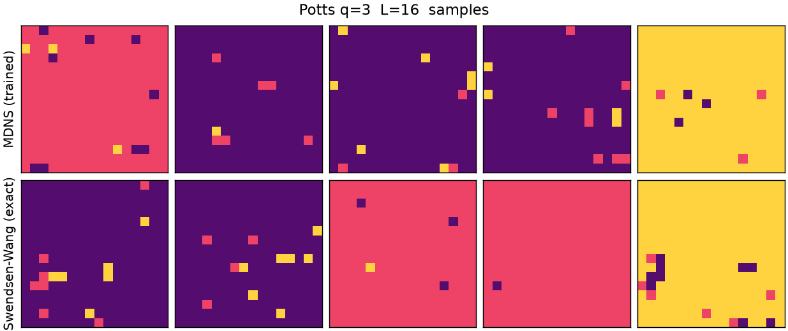
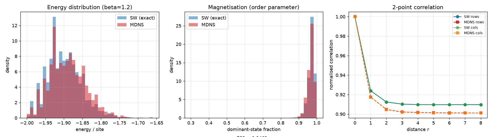

# 最佳权重的采样质量评估（Potts L=16, β=1.2）

评估对象：`results/remote_L16/best.pt`（第 54 轮，EMA 权重，0.168 M 参数）
参照：C++ Swendsen-Wang（已用精确枚举校验 8/8）· 各 4096 个样本 · 4080S 上生成

## 1. 总览

| 指标 | MDNS | SW（精确） | 差距 |
|---|---|---|---|
| 采样器自身 ESS | **0.9462** | — | 权重近乎均匀 ⇒ q_θ≈π |
| 平均能量/格点 | −1.89004 | −1.89862 | **+0.45%** |
| 能量标准差 | 0.0483 | 0.0456 | +6%（分布略宽） |
| 能量分布 TV | **0.0862** | — | （完全错误时为 1.0） |
| 主导态占比（均值） | 0.9662 | 0.9692 | −0.003 |
| 主导态占比（分布 TV） | **0.0601** | — | — |
| 两点关联最大绝对误差 | **0.0087** | — | 相对 ~0.91 的基线约 **1%** |

## 2. 样本图



上排 MDNS、下排 SW。两者的形态完全一致：单一色块占据绝大部分格点（有序相的主畴），
稀疏分布着另外两个态的"液滴"（激发）。**三种颜色都出现，Z₃ 对称性没有被破坏**——
这一点很关键，它排除了"模型塌缩到某一个特定基态"的失败模式。

## 3. 观测量对比



- **能量分布**：高度重叠，MDNS 整体右移一点点（能量偏高 0.45%），并且在 −1.85 附近多出一个小鼓包。
- **磁化强度**：两者都在 0.97 处尖峰，但 MDNS 的分布略宽（std 0.0183 vs 0.0169）、左侧拖尾略长。
- **两点关联**：行/列两个方向各自内部完全重合（各向同性 OK），MDNS 的平台值 0.901 vs SW 0.910。

## 4. 判断

**结论：合格，但是"系统性偏热"的合格。**

三个观测量都指向**同一个**物理偏差：能量偏高、磁化略弱、长程关联略低。
这不是噪声（4096 样本，且 ESS 0.946 说明有效样本量接近名义值），而是模型把目标分布
学得**稍微软了一点**——相当于有效 β 比 1.2 略低（约 1.19 量级）。

可能的来源：

1. **β=1.2 只训到了最后约 10 轮**（0.2→1.2 线性退火，第 45 轮才越过 1.0）。真正在目标温度上的
   优化步数只有约 7000 步，模型还没来得及把尾部结构学紧。
2. 门控指标是留出集 NLL，它对"略软的分布"并不敏感——NLL 在 0.1517 附近已进入平台，
   继续训练对 NLL 的收益很小，但对能量/关联这类**慢变量**仍有可见影响。

**做得好的地方**：ESS 0.946、关联函数误差 1%、能量 TV 0.086、三个磁化扇区都正确出现。
考虑到只有 0.168 M 参数、2.38 小时、单张 4080S，这个结果是可信的。

## 5. 下一步若要改进

| 手段 | 预期 |
|---|---|
| 固定 β=1.2 续跑 2 小时（不做退火） | 直接压掉"偏热"，最容易见效 |
| 把门控指标改成"能量 TV"或"能量均值偏差" | 让门控直接优化物理量，而不是 NLL |
| 加大模型（`res-m`/`res-l`） | 0.168 M 可能限制了尾部精度 |
| 增加 scan_batch（1024→4096） | 降低重要性权重的方差，梯度更准 |

## 6. 复现

```bash
python scripts/eval_checkpoint.py --ckpt runs/potts_L16_b1.2/best.pt \
    --beta 1.2 --n 4096 --out results/eval_b1.2
```
