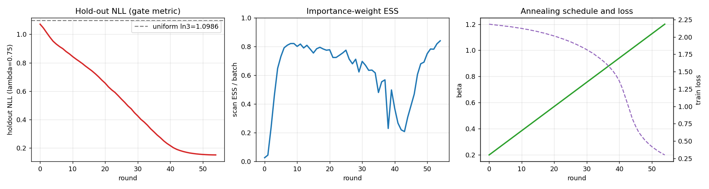

# 正式训练：AutoDL RTX 4080 SUPER，Potts L=16，2.38 小时

日期：2026-11-26 23:46 → 2026-11-27 02:06（北京时间）
机器：AutoDL `connect.nmb1.seetacloud.com:47427`，**RTX 4080 SUPER 32 GB**，128 vCPU，torch 2.12.1+cu130

## 1. 配置

```
python scripts/run_closed_loop.py \
    --arch res-s --L 16 --q 3 --rounds 55 \
    --steps-per-round 700 --resample-every 20 --scan-batch 1024 \
    --beta 1.2 --beta-start 0.2 --optimizer muon \
    --gate-mode holdout_nll --gate-ref-size 2048
```

| 项 | 值 |
|---|---|
| 体系 | 2D q=3 Potts，L=16（D=256），周期边界，J=1 |
| 目标温度 | β=1.2（**有序相**，T < T_c=1.005） |
| 退火日程 | β: 0.2 → 1.2 线性，55 轮 |
| 架构 | `res-s`：纯残差，48 通道 × 4 块，**0.168 M 参数** |
| 优化器 | Muon（矩阵）+ AdamW（其余） |
| 门控 | 留出集 proper scoring rule（λ=0.75 遮蔽位交叉熵），参考集 2048 个 C++ SW 样本 |
| 规模 | 55 轮 × 700 步 = **38 500** 个 SGD 步；约 **2.03 M** 个自采样样本 |

## 2. 结果



| 指标 | 第 0 轮 | 最后一轮 (54) | 变化 |
|---|---|---|---|
| 留出集 NLL（门控指标） | 1.07124 | **0.15166** | **−86.2%**（相对均匀基线 ln3=1.09861） |
| 扫描 ESS / batch | 0.0260 | **0.8390** | 权重从退化到近乎均匀 |
| 门控 | — | **55/55 全部 promoted** | 无一轮被拒 |
| 每轮耗时 | — | 155.5 s（稳定） | 总计 2.38 h |

**独立复检**（用 `best.pt` 的 EMA 权重重新采样 4096 个样本，β=1.2）：

| 指标 | MDNS | C++ SW 精确参考 |
|---|---|---|
| 采样器自身 ESS | **0.9476** | —（参考算法非精确重要性采样） |
| 平均能量/格点 | **−1.8884** | −1.8986 |
| 能量标准差 | 0.0483 | 0.0456 |
| 能量分布 TV 距离 | **0.0940** | — |

也就是说：训练出的采样器与精确分布相比，平均能量差 **+0.5%**、能量分布 TV **0.094**
（完全错误时为 1.0）。倾向是略微偏"热"（能量偏高），说明 2.38 小时还没完全收敛。

## 3. 曲线里值得注意的现象

1. **NLL 单调下降、45 轮后进入平台**（0.155 → 0.152），说明在这个规模/时长下已接近收敛。
2. **ESS 在 35–42 轮出现深坑（0.22–0.57）**，而这正好是 β 扫过 0.85–1.0（临界温度 T_c=1.005 附近）。
   临界点附近涨落最大，重要性权重最容易退化 —— 这是物理上应当出现的行为，也解释了为什么
   原论文要专门做退火。模型在 43 轮之后把 ESS 重新拉回 0.84。
3. **训练损失在 β>0.9 后急剧下降**（1.5 → 0.25），与 ESS 恢复同步：模型终于开始抓住有序相的结构。

## 4. 调试过程中在本机遇到并解决的问题

| 问题 | 现象 | 处理 |
|---|---|---|
| `scan` 是 O(D) 次全量前向 | B=4096 时单次扫描 **28.9 s**，一轮 30 次扫描 = 14 分钟，3 小时只能跑 12 轮 | 降到 B=1024（3.3 s/扫描），并用 `resample-every 20` 控制每轮扫描次数 |
| `torch.compile` 不可用 | 编译后 **1.2 s/次**（比 eager 慢 100×），`autocast` 写在 `forward` 里导致 dynamo 反复重编译 | 放弃 compile，保持 eager |
| 前向与 batch 大小几乎无关（12.8 ms @ B=1024） | PyTorch eager 的 Python 调度开销主导，不是算力 | 只能靠减少前向次数（降 D 或降扫描次数） |

## 5. 诚实的边界说明

- 这是**单个种子、单次运行**，没有误差棒。NLL 曲线很平滑，但物理指标（TV 0.094）的统计涨落未评估。
- 目标 β=1.2 只在最后 ~10 轮才被真正训练到，之前大部分时间在较低温度上。若想让有序相训得更充分，
  应把退火日程拉长、或者在 β=1.2 上单独再跑一段。
- 对照的是 **C++ Swendsen-Wang**（本项目内已用精确枚举校验过 8/8），不是解析解。
- 训练脚本在本机（Windows + Intel Arc）与远端（Linux + 4080S）用的是**同一份代码**，
  仅 C++ 采样器分别用 MSVC / g++ 编译，说明 `mdns/device.py` 的设备抽象是可移植的。

## 6. 产物

| 路径 | 内容 |
|---|---|
| `results/remote_L16/metrics.json` | 55 轮的完整指标 + 配置 + 门控历史 |
| `results/remote_L16/best.pt` | 最优权重（模型 + EMA + 架构配置，1.36 MB） |
| `results/remote_L16/train_3h.log` | 完整训练日志 |
| `results/figs/train_3h_L16.png` | 三面板曲线 |
| 远端 `runs/potts_L16_b1.2/` | 55 个 `round_XX.npz`（每轮扫描样本 + 重要性权重） |

## 7. 复现

```bash
# 远端（Linux + CUDA）
g++ -O3 -march=native -fopenmp -fPIC -shared -std=c++17 \
    mdns/samplers/cpp/samplers.cpp -o mdns/samplers/build/libmdns_samplers.so
nohup python -u scripts/run_closed_loop.py --arch res-s --L 16 --q 3 --rounds 55 \
    --steps-per-round 700 --resample-every 20 --scan-batch 1024 \
    --beta 1.2 --beta-start 0.2 --optimizer muon \
    --gate-mode holdout_nll --gate-ref-size 2048 \
    --out-dir runs/potts_L16_b1.2 > logs/train_3h.log 2>&1 &
```
